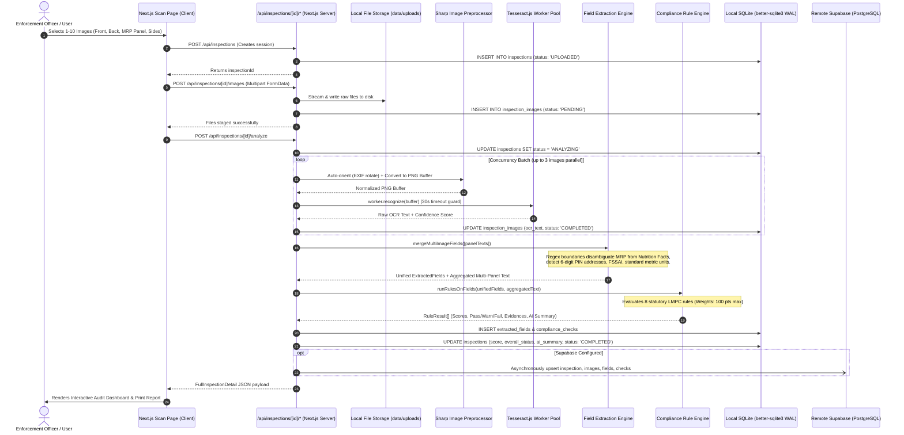
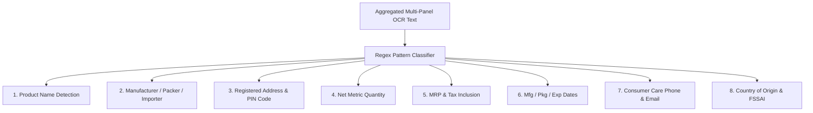

# LegalMetrix: A-to-Z Technical Deep Dive & System Architecture

> **Audience**: Software Engineers, Technical Architects, Machine Learning Engineers, and Hackathon Evaluators.  
> **Repository**: [pragyangoyal/LegalMetrix](https://github.com/pragyangoyal/LegalMetrix)  
> **Problem Statement**: SIH 2026 Problem ID 26034 (Ministry of Consumer Affairs, Food & Public Distribution — Legal Metrology Division)  
> **Core Objective**: Automated Verification of Statutory Declarations on Packaged Commodities under the Legal Metrology (Packaged Commodities) Rules, 2011.

---

## 1. High-Level Architecture Overview

LegalMetrix is built as an edge-ready, hybrid-storage full-stack application designed to run entirely locally (for zero-latency inspection in field or warehouse settings with poor connectivity) while maintaining dual-write cloud sync capabilities to Supabase PostgreSQL.

### Technology Stack Matrix

| Layer | Technology | Key Modules / Packages | Role |
| :--- | :--- | :--- | :--- |
| **Framework** | Next.js 16 (App Router) | `next`, `react`, `react-dom` | Full-stack SSR, API routes, and client-side UI |
| **Language** | TypeScript 5 (Strict) | `typescript`, `@types/*` | End-to-end type safety across DB, API, and UI |
| **Styling & Icons** | Tailwind CSS + Lucide Icons | `tailwindcss`, `lucide-react`, `clsx` | Responsive UI, dark/light accents, `@media print` reports |
| **Image Pipeline** | Sharp + Tesseract.js | `sharp`, `tesseract.js` | EXIF re-orientation, format conversion, and OCR worker threads |
| **Local Persistence** | SQLite3 (Embedded) | `better-sqlite3`, `uuid` | Zero-latency WAL-mode ACID transactions & foreign key integrity |
| **Cloud Persistence** | Supabase (PostgreSQL) | `@supabase/supabase-js` | Remote backups, cross-officer sync, row-level security (RLS) |
| **Validation Engine** | Custom Deterministic NLP | TypeScript regex & lexicon engines | 8 statutory rule checks (LMPC Rules 2011) |

---

## 2. End-to-End System Data Flow

The following sequence illustrates what occurs when an enforcement officer or manufacturer uploads product images for statutory inspection:



---

## 3. Image Pre-Processing & OCR Pipeline

Real-world commodity packaging photos suffer from rotation artifacts, skewed camera angles, glare on metallic foil, and modern container formats like HEIC (Apple) or WebP/AVIF. 

LegalMetrix resolves these issues in `lib/server/ocrService.ts`:

### 3.1 Sharp Image Normalization
Before sending image bytes to the OCR engine, Sharp processes each buffer:
1. **EXIF Auto-Orientation (`.rotate()`)**: Camera orientation flags are evaluated and burned into the pixel matrix so vertical text remains upright.
2. **Format Normalization (`.toFormat('png')`)**: Converts diverse inputs (AVIF, WebP, HEIC, JPEG, TIFF) into lossless PNG buffers that Tesseract's Leptonica backend parses natively without image decoding failures.
3. **Graceful Fallback**: If Sharp fails on corrupted metadata, the system catches the exception and falls back to raw buffer consumption.

```typescript
// lib/server/ocrService.ts
let normalizedInput: Buffer = imageBuffer;
try {
  const sharp = (await import('sharp')).default;
  normalizedInput = await sharp(imageBuffer)
    .rotate() // Auto-orient based on camera EXIF
    .toFormat('png')
    .toBuffer();
} catch (sharpErr) {
  console.warn('Sharp format conversion fallback to raw buffer:', sharpErr);
  normalizedInput = imageBuffer;
}
```

### 3.2 Tesseract.js Worker Management & Timeout Safety
- **Explicit Worker Script Path**: In Next.js Node server runtimes, dynamic worker bundling can break default path resolutions. The code resolves `node_modules/tesseract.js/src/worker-script/node/index.js` explicitly.
- **Worker Concurrency Limit**: Batch concurrency is capped at `3` simultaneous workers using `Promise.all` slice chunking in `lib/server/analysisService.ts`, preventing CPU core thrashing.
- **30-Second Timeout Race Guard**: To prevent deadlocks on ultra-dense images, OCR recognition is raced against an asynchronous rejection timer:

```typescript
const ocrPromise = worker.recognize(normalizedInput);
const timeoutPromise = new Promise<never>((_, reject) =>
  setTimeout(() => reject(new Error('OCR Timeout after 30s')), 30000)
);

const ret = await Promise.race([ocrPromise, timeoutPromise]);
await worker.terminate().catch(() => {});
```

---

## 4. Multi-Panel Aggregation & NLP Field Extraction Engine

Package compliance cannot be verified from a single photo: the front panel contains the brand and net weight, the back panel has nutrition and consumer care, and the bottom or crimp seal contains the batch number and MRP stamp.

### 4.1 Multi-Panel Fusion Strategy
In `lib/server/fieldExtractionService.ts`, the `mergeMultiImageFields()` function aggregates text across all panels:
1. Each panel is tagged with a human label (`Front Panel`, `Back Panel`, `MRP & Batch Panel`, etc.).
2. Panel texts are joined with deterministic delimiters (`--- Next Panel / Side ---`).
3. Extracted fields from all panels are deduplicated: the first high-confidence detection is recorded while preserving the `sourceImageId` linking every declaration back to its physical panel photo.

### 4.2 Deterministic NLP Extraction Logic
Rather than relying on hallucination-prone Large Language Models for regulatory enforcement, LegalMetrix uses a strict, deterministic regex grammar tuned to Indian packaging standards:



#### Key Regex Solutions to Real-World Edge Cases:

1. **MRP Disambiguation vs Nutrition Facts**:
   - *Problem*: OCR on cereal boxes frequently extracted "Total Sugars 2g" or "Sodium 150mg" as prices.
   - *Fix*: Strict lookaheads enforce currency markers (`₹`, `Rs.`, `INR`) and tax declaration clauses (`inclusive of all taxes` / `incl. of all taxes`):
     ```regex
     \b(?:m\.?r\.?p\.?|maximum retail price)\s*[:=]?\s*(?:₹|rs\.?|inr)?\s*([\d,]+(?:\.\d{2})?(?:\s*\/\-)?(?:\s*\(?incl\.?(?:usive)?\s*(?:of)?\s*all\s*taxes\)?)?)
     ```

2. **Net Quantity vs Serving Sizes**:
   - *Problem*: Nutritional panels contain "Serving Size 30g" which could be misidentified as net weight.
   - *Fix*: Strict prefix matching requires `Net Qty`, `Net Wt`, `Net Contents`, or `Net Volume`:
     ```regex
     \bnet\s*(?:qty|quantity|wt\.?|weight|vol\.?|volume|contents?)\s*[:=]?\s*([\d.,]+\s*(?:kg|g|gm|grams?|ml|litre|liter|l\b|pieces?|pcs|units?))
     ```

3. **Address Verification with 6-Digit Indian Postal Codes**:
   - Multi-line addresses are validated by checking for 6-digit PIN codes (`\d{6}`) or a gazetteer of Indian state names (Maharashtra, Karnataka, Haryana, etc.).

4. **Consumer Care Multi-Channel Extraction**:
   - Extracts toll-free numbers (`1800-xxx-xxxx`), Indian mobile formats (`+91` followed by 10 digits), and standard email addresses (`user@domain.ext`).

---

## 5. Statutory Compliance Rules Engine (LMPC Rules, 2011)

The compliance engine in `rules/complianceRules.ts` and `lib/server/complianceEngine.ts` implements an 8-rule scoring matrix based directly on **Rule 6 of the Legal Metrology (Packaged Commodities) Rules, 2011**:

| Rule ID | Rule Name | Statutory Basis | Severity | Max Weight | Logic / Criteria |
| :---: | :--- | :--- | :---: | :---: | :--- |
| **R01** | Product Identity | Rule 6(1)(a) | Critical | **10** | **PASS**: Clear commodity name detected.<br/>**WARN**: Ambiguous text present.<br/>**FAIL**: No identity found. |
| **R02** | Manufacturer / Packer / Importer | Rule 6(1)(a) | Critical | **15** | **PASS**: "Manufactured by", "Packed by", or "Imported by" entity detected.<br/>**FAIL**: Absent. |
| **R03** | Registered Address | Rule 6(1)(a) | Major | **10** | **PASS**: Complete address with PIN code or State.<br/>**WARN**: Address without PIN.<br/>**FAIL**: Missing. |
| **R04** | Net Quantity | Rule 6(1)(b) & Schedule II | Critical | **15** | **PASS**: Declared in standard metric units (`g`, `kg`, `ml`, `l`).<br/>**WARN**: Non-standard format.<br/>**FAIL**: Missing. |
| **R05** | Maximum Retail Price (MRP) | Rule 6(1)(f) | Critical | **20** | **PASS**: MRP in INR with "incl. of all taxes".<br/>**WARN**: Price without tax clause.<br/>**FAIL**: Missing. |
| **R06** | Date of Manufacture / Packing | Rule 6(1)(d) | Major | **15** | **PASS**: Valid month/year format (`MM/YYYY` or `Month YYYY`).<br/>**WARN**: Ambiguous date.<br/>**FAIL**: Missing. |
| **R07** | Consumer Care Details | Rule 6(1)(k) | Major | **10** | **PASS**: Both contact number AND email detected.<br/>**WARN**: Only phone or only email.<br/>**FAIL**: Neither. |
| **R08** | Country of Origin | Rule 6(1)(n) / CPA 2019 | Minor | **5** | **PASS**: Explicit origin country declared.<br/>**WARN**: Not explicitly stated. |
| **TOTAL** | | | | **100** | |

### Scoring Algorithm & Thresholds
Each rule validator returns a `RuleResult` with status `PASS`, `WARNING`, or `FAIL`.

$$\text{Score Earned} = \sum_{r \in \text{Rules}} \begin{cases} \text{maxScore}(r) & \text{if status} = \text{PASS} \\ \lfloor 0.5 \times \text{maxScore}(r) \rfloor & \text{if status} = \text{WARNING} \\ 0 & \text{if status} = \text{FAIL} \end{cases}$$

$$\text{Compliance Score} = \left\lfloor \frac{\sum \text{Score Earned}}{\sum \text{Max Score}} \times 100 \right\rfloor$$

- **$\ge 90$**: `COMPLIANT` (Green) — All mandatory statutory declarations verified.
- **$70 - 89$**: `WARNING` (Amber) — Partial or non-standard declarations (e.g. missing PIN code or missing email).
- **$< 70$**: `NON-COMPLIANT` (Red) — Critical violations detected (missing MRP, net quantity, or manufacturer name).

---

## 6. Database Architecture & Dual-Write Persistence

LegalMetrix uses a dual-database model:
1. **Primary Local Layer**: SQLite (`better-sqlite3`) for instant synchronous persistence and zero-latency local operation.
2. **Remote Cloud Layer**: Supabase PostgreSQL for cross-device synchronization and regulatory audit archiving.

```
                    ┌────────────────────────┐
                    │ Next.js Backend Engine │
                    └───────────┬────────────┘
                                │
               ┌────────────────┴────────────────┐
               ▼                                 ▼
      [ Synchronous Write ]             [ Async Fire-and-Forget ]
  ┌───────────────────────┐             ┌───────────────────────┐
  │  SQLite3 (Local Disk) │             │  Supabase PostgreSQL  │
  │  WAL Mode, Foreign Key│             │  Cloud DB + RLS       │
  │  legalmetrix.db       │             │  Multi-Inspector Sync │
  └───────────────────────┘             └───────────────────────┘
```

### 6.1 SQLite Optimization (`lib/server/db.ts`)
- **Write-Ahead Logging (`PRAGMA journal_mode = WAL`)**: Allows concurrent read access during multi-image write operations.
- **Foreign Key Enforcement (`PRAGMA foreign_keys = ON`)**: Cascades deletion from `inspections` down to `inspection_images`, `extracted_fields`, and `compliance_checks`.
- **Global Singleton (`global.__legalmetrixDb`)**: Prevents Next.js development hot-reloading from creating redundant file locks on the `.db` file.

### 6.2 Relational Schema (DDL)

```sql
-- 1. Master Inspection Records
CREATE TABLE inspections (
  id TEXT PRIMARY KEY,
  created_at TEXT NOT NULL,
  updated_at TEXT NOT NULL,
  status TEXT NOT NULL DEFAULT 'UPLOADED', -- 'UPLOADED' | 'ANALYZING' | 'COMPLETED' | 'FAILED'
  scan_mode TEXT NOT NULL DEFAULT 'upload', -- 'upload' | 'camera' | 'demo' | 'listing'
  product_name TEXT,
  compliance_score INTEGER,
  overall_status TEXT,                    -- 'COMPLIANT' | 'WARNING' | 'NON-COMPLIANT'
  raw_ocr_text TEXT,
  ai_summary TEXT,
  processing_time_ms INTEGER DEFAULT 0,
  images_count INTEGER DEFAULT 0,
  images_analyzed INTEGER DEFAULT 0,
  demo_product_id TEXT
);

-- 2. Inspection Images (Multi-Panel Support)
CREATE TABLE inspection_images (
  id TEXT PRIMARY KEY,
  inspection_id TEXT NOT NULL REFERENCES inspections(id) ON DELETE CASCADE,
  filename TEXT NOT NULL,
  original_name TEXT NOT NULL,
  mime_type TEXT NOT NULL,
  size_bytes INTEGER NOT NULL,
  image_order INTEGER NOT NULL DEFAULT 0,
  label TEXT,                             -- e.g., 'Front Panel', 'MRP & Batch Panel'
  file_path TEXT NOT NULL,
  status TEXT NOT NULL DEFAULT 'PENDING',  -- 'PENDING' | 'ANALYZING' | 'COMPLETED' | 'FAILED'
  ocr_text TEXT,
  ocr_confidence REAL,
  processing_time_ms INTEGER DEFAULT 0,
  created_at TEXT NOT NULL
);

-- 3. Extracted Statutory Fields
CREATE TABLE extracted_fields (
  id TEXT PRIMARY KEY,
  inspection_id TEXT NOT NULL REFERENCES inspections(id) ON DELETE CASCADE,
  field_name TEXT NOT NULL,               -- e.g., 'mrp', 'netQuantity', 'manufacturer'
  value TEXT NOT NULL,
  confidence REAL DEFAULT 0.0,
  source_image_id TEXT,
  status TEXT NOT NULL DEFAULT 'DETECTED'
);

-- 4. Compliance Rule Check Results
CREATE TABLE compliance_checks (
  id TEXT PRIMARY KEY,
  inspection_id TEXT NOT NULL REFERENCES inspections(id) ON DELETE CASCADE,
  rule_id TEXT NOT NULL,                  -- 'R01' to 'R08'
  rule_name TEXT NOT NULL,
  category TEXT NOT NULL,
  severity TEXT NOT NULL,                 -- 'critical' | 'major' | 'minor'
  status TEXT NOT NULL,                   -- 'PASS' | 'WARNING' | 'FAIL'
  message TEXT,
  evidence TEXT,
  explanation TEXT,
  confidence REAL DEFAULT 0.0,
  score_earned INTEGER DEFAULT 0,
  max_score INTEGER DEFAULT 0
);
```

### 6.3 Supabase Asynchronous Sync (`lib/server/supabaseService.ts`)
- The sync process executes as a non-blocking background promise after SQLite commit.
- If environment credentials (`NEXT_PUBLIC_SUPABASE_URL` and `NEXT_PUBLIC_SUPABASE_ANON_KEY`) are missing, the sync gracefully bypasses without interrupting the user.
- Uses batch `.upsert()` calls to update all child tables (`inspection_images`, `extracted_fields`, `compliance_checks`) atomically.

---

## 7. REST API Architecture & Endpoints

| Endpoint | Method | Input | Output | Purpose |
| :--- | :---: | :--- | :--- | :--- |
| `/api/inspections` | `GET` | `?status=&search=&limit=&offset=` | `InspectionRecord[]` | Paginated listing of past inspections with status filtering |
| `/api/inspections` | `POST` | `{ scanMode, productName }` | `InspectionRecord` | Initializes a new inspection session |
| `/api/inspections` | `DELETE` | None | `{ success: true }` | Clears local history database |
| `/api/inspections/[id]` | `GET` | Route param `id` | `FullInspectionDetail` | Retrieves complete inspection record with all joined tables |
| `/api/inspections/[id]` | `DELETE` | Route param `id` | `{ success: true }` | Deletes inspection and cleans up local image files |
| `/api/inspections/[id]/images` | `POST` | Multipart `FormData` (files + labels) | `InspectionImageRecord[]` | Uploads and registers up to 10 panel images |
| `/api/inspections/[id]/analyze` | `POST` | Route param `id` | `FullInspectionDetail` | Triggers Sharp + OCR + Rule Engine execution pipeline |
| `/api/inspections/[id]/report` | `GET` | Route param `id` | `ReportData` | Pre-calculated statutory summary for PDF/print export |
| `/api/inspections/demo` | `POST` | `{ demoProductId }` | `FullInspectionDetail` | Instantly seeds and analyzes a built-in test commodity |
| `/api/inspections/text` | `POST` | `{ text, title }` | `FullInspectionDetail` | Directly audits raw e-commerce product listing text |
| `/api/uploads/[...path]` | `GET` | Dynamic file path | Binary Image Stream | Securely streams uploaded images to client browser |

---

## 8. Front-End Architecture & User Experience

### 8.1 State Management & Step Animations (`app/scan/page.tsx`)
The inspection flow utilizes a sequential multi-step visual pipeline:
1. `Creating inspection session...`
2. `Uploading product package images...`
3. `Processing multi-image OCR panels...`
4. `Aggregating declarations across sides...`
5. `Validating Legal Metrology Rules (2011)...`
6. `Generating statutory compliance report...`

### 8.2 Audit Dashboard (`app/result/page.tsx`)
The results view contains four dedicated analytical views:
- **Compliance Score Card**: Radial/bar gauge with color-coded status badge and summary breakdown.
- **Rule Matrix**: Expandable accordion cards displaying statutory rule descriptions, legal citations, extracted evidence, and remediation advice.
- **Detected Declarations Grid**: Key-value display of all 16 extracted packaging declarations.
- **Multi-Panel Image Inspector**: Side-by-side view of scanned panel images with image-level OCR text and confidence metrics.

### 8.3 Print-Ready Statutory Report (`app/report/page.tsx`)
- Includes a dedicated `@media print` CSS stylesheet that hides navigation headers, sidebars, and interactive buttons.
- Formatted as an official **Government of India / Legal Metrology Inspection Certificate** with designated signature blocks for the Inspecting Officer and Store Manager.

---

## 9. Performance & Resiliency Engineering

1. **Memory Leak Mitigation**: Tesseract workers spawn child worker processes in Node.js. If left unmanaged, repeated scans will exhaust system RAM. LegalMetrix strictly enforces `await worker.terminate()` inside `try...finally` blocks.
2. **Buffer Stream Handling**: Uploaded files are streamed directly into isolated subdirectories (`data/uploads/<inspection_id>/`) rather than cached in application memory.
3. **Graceful Network Degradation**: The inspection pipeline runs 100% locally if internet connectivity is lost; remote Supabase replication automatically recovers when connectivity is restored.
4. **Deterministic Testing**: Includes 4 pre-configured demo products in `data/demoProducts.ts` covering fully compliant packages, missing MRP packages, and ambiguous date declarations for instant offline demonstration.

---

## 10. Summary Checklist for Technical Discussions

When presenting LegalMetrix to senior technical evaluators, emphasize these 5 core engineering decisions:

1. **Deterministic Regulatory Engine**: Unlike generative AI models that hallucinate packaging laws, LegalMetrix uses a verifiable, deterministic rules engine that cites specific clauses under Rule 6 of the LMPC Rules 2011.
2. **Multi-Panel Geometry**: Products are 3-dimensional. LegalMetrix aggregates up to 10 distinct panel photos (Front, Back, Top, Bottom, Sides) into a unified semantic inspection model.
3. **Sharp + Tesseract Preprocessing**: By normalizing images to upright PNG buffers before optical character recognition, the system eliminates rotation and format incompatibilities.
4. **Resilient Hybrid Database**: Immediate local SQLite WAL storage ensures zero field downtime, paired with asynchronous Supabase cloud replication.
5. **Print-Ready Official Workflow**: Generates defensible, signed inspection reports suitable for legal proceedings under the Legal Metrology Act, 2009.
